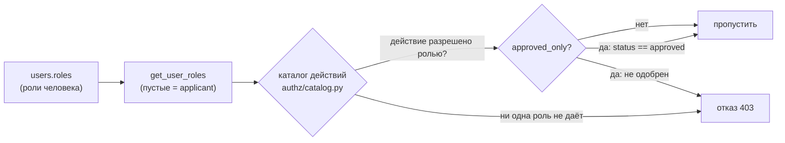

# RBAC: действия вместо имён ролей

> _Последнее редактирование: 2026-10-10_ · вариант O3 (A1), решение владельца 2026-10-10

## 1. Принцип в одном абзаце

Код больше не спрашивает «есть ли у человека роль `manager`». Он спрашивает
«разрешено ли ему **действие** `staff.manage`». Какие роли дают какое
действие, записано в одном месте — каталоге
[`uk_management_bot/authz/catalog.py`](../../uk_management_bot/authz/catalog.py),
одна строка на действие. Роли по-прежнему хранятся в `users.roles`, новых таблиц
нет. Изменить, кто что может, — значит поправить строку каталога. Снимок прав
(§7) покажет, кто именно получил или потерял доступ.

## 2. Три понятия

| Понятие | Что это | Где живёт |
|---|---|---|
| **Роль** | Кто человек: `applicant`, `executor`, `manager`, `inspector`, `admin`, `system_admin`, `security_operator`, капабилити `resource_meter_entry` | `users.roles` (jsonb), канонический резолвер `utils/auth_helpers.get_user_roles` |
| **Действие** | Именованная операция + роли, которые её разрешают + требуется ли одобренный аккаунт | `authz/catalog.py` |
| **Проверка** | «Разрешено ли этому человеку это действие» | `authz.can`, `require_action`, `ActionGate`, `useCan` |

Правила проверки:

- **Отказ по умолчанию.** Пустой набор ролей, неизвестная роль, неизвестное
  действие не дают ничего. Неизвестный ключ действия — ошибка при импорте модуля
  или при сборке фронта, а не тихий отказ.
- **Роли объединяются.** Человек с ролями `executor` и `manager` может всё, что
  разрешено любой из них.
- **`active_role` прав не даёт.** Это режим меню бота (A9-P3-11).
- **Статус** проверяется только у действий с `approved_only`. Так работали и прежние
  гейты: `require_approved_roles` смотрел статус, `require_roles` — нет (см. §8).

## 3. Как пользоваться

| Где | Как проверить | Пример |
|---|---|---|
| Маршрут API | `Depends(require_action("..."))` из `api/dependencies` | `user: User = Depends(require_action("staff.manage"))` |
| Хендлер бота | декоратор `@require_action("...")` из `middlewares/auth` | `@require_action("admin_panel.use")` |
| Роутер бота целиком | root-фильтр `ActionGate("...")` из `handlers/_role_gate` | `router.message.filter(ActionGate("elevators.technician"))` |
| Ветвление в коде | `authz.can(user, "...")` — с учётом статуса; `authz.has_action_roles(user_or_roles, "...")` — только роли | `if not has_action_roles(user, "requests.manage"): raise ...` |
| API охраны | `require_action(...)` и `utils.auth_helpers.action_allowed_for_roles(...)` | граница AUD5-ARCH-4 пускает в access_control только контрактные модули ядра |
| Веб-интерфейс | `useCan("...")`, `<ProtectedRoute action="...">`, поле `action` пункта меню | `const canManage = useCan('access.registry.manage')` |

Интерфейс получает список своих действий в профиле (`GET /api/v2/profile` →
`actions`) и по нему показывает разделы и кнопки. **Это подсказка, а не
защита:** каждый запрос сервер проверяет сам. Список вычисляется по ролям без
учёта статуса — так же, как раньше интерфейс смотрел только на роли.

Тип `ActionKey` на фронте выводится из сгенерированной копии каталога
(`frontend/src/authz/catalog.generated.json`), поэтому опечатка в ключе даёт
ошибку компиляции.

## 4. Что правом НЕ является (и остаётся сравнением роли)

- **Роль как признак человека-объекта.** «Назначить на смену можно только
  исполнителя», «в инвайте допустимы такие роли», «аккаунт заведён менеджером»
  (`_is_privileged`), подпись роли в карточке сотрудника. Это свойство того,
  *над кем* действуют, а не право того, *кто* действует.
- **`active_role` — режим меню бота.** «Мои заявки» в режиме исполнителя
  показывают назначенные, в режиме жителя — поданные. Доступ к конкретной заявке
  всё равно решает `utils/request_access.access_reason`, уже на действиях.
- **Персоны Mini App (TWA).** `RoleGuard`/`RoleLanding` выбирают экран жителя,
  исполнителя или обходчика. Операции внутри экранов сервер проверяет действиями.
- **Отношения к объекту.** Автор заявки, назначенный исполнитель, активная смена,
  одобренный сосед проверяются гардами workflow и `access_reason` поверх
  действия, а не вместо него.

Все оставшиеся сравнения роли со строкой перечислены в инвентаре
`tests/rbac_baseline/inline_checks.json`. Ратчет не даёт добавлять новые.

## 5. Как изменить права

**Дать или забрать действие у роли.**
1. Поправить роли действия в `authz/catalog.py`.
2. `python tests/rbac_baseline/builder.py --check` покажет, какие маршруты и
   хендлеры у каких ролей изменились.
3. Если изменение задумано: `--write`, `python -m uk_management_bot.authz.export --write`
   (копия для фронта), обновить таблицу §9 (`--markdown`), в описании PR — дифф
   снимка и решение владельца.

**Новое действие.** Добавить строку в каталог (ключ `модуль.операция`, роли,
описание, при необходимости `approved_only=True`), выгрузить копию для фронта и
использовать ключ в коде. Действия бота не могут быть `approved_only`: гейты
бота статус не проверяют, `require_action`/`ActionGate` откажутся их принять.

**Новый маршрут или хендлер.** Только через `require_action` / `ActionGate` /
`can`. Гейт по имени роли (`require_roles`, `require_approved_roles`,
`@require_role`, `RoleGate(...)`) роняет тест
`test_no_role_name_gates_in_production_code`.

## 6. Где что лежит

| Файл | Назначение |
|---|---|
| `uk_management_bot/authz/catalog.py` | Каталог действий — единственное место «кто что может» |
| `uk_management_bot/authz/policy.py` | `can`, `has_action_roles`, `roles_of` |
| `uk_management_bot/authz/export.py` | Выгрузка каталога для фронта и для этой документации |
| `uk_management_bot/api/dependencies.py` | `require_action` для FastAPI |
| `uk_management_bot/middlewares/auth.py` | `require_action` для хендлеров бота |
| `uk_management_bot/handlers/_role_gate.py` | `ActionGate` — root-фильтр роутера бота |
| `uk_management_bot/utils/auth_helpers.py` | Ролевые предикаты бота поверх каталога; `action_allowed_for_roles` для охраны |
| `frontend/src/authz/` | Копия каталога, `ActionKey`, `hasAction` |
| `frontend/src/hooks/useCan.ts` | Хук гейтов интерфейса |
| `tests/rbac_baseline/` | Снимок прав и его генератор |

## 7. Как доказано, что права не изменились

Переход выполнен **без изменения полномочий**. Это проверяется так:

1. **Снимок прав по результату** (`tests/rbac_baseline/*.json`). Каждый гейт API
   ядра (207 маршрутов), API охраны (67) и бота (100 гейтов) вызывается
   по-настоящему с синтетическими пользователями всех сочетаний ролей обоих продов
   плюс граничными (пустые роли, pending). Снимок снят ДО перевода (этап 0) и
   совпал ПОСЛЕ — для всех трёх матриц. Мутационная проверка: смена набора ролей
   одного маршрута ловится с диффом «кто получил или потерял доступ».
2. **Спецификация предикатов** (`test_rbac_role_predicates.py`). Явная таблица
   «предикат × профиль» для `has_admin_access`, `has_manager_role`,
   `has_executor_access`, `get_user_roles`, `RoleGate`, `is_manager`, `_is_manager`.
3. **Спецификация интерфейса** (`frontend/src/authz/uiActions.test.ts`). Для каждого
   действия, которое использует интерфейс, явно записано, какие роли видят раздел
   или кнопку.
4. **Ратчеты.** Нет гейтов по именам ролей в продакшен-коде. Сравнений роли со
   строкой становится только меньше. Копия каталога во фронте не устаревает.

**Единственное сознательное изменение видимости в интерфейсе:** раздел «Учёт
ресурсов» теперь видит и `admin`. API пускал его туда всегда (`resources.launch`),
а интерфейс прятал. Серверные права не изменились.

## 8. Особенности текущих прав (зафиксированы, ждут решения владельца)

Снимок обнаружил поведение, которое переход сознательно **сохранил**, а не исправил:

1. **Статус проверяется не везде.** Действия без `approved_only` пропускают
   pending-аккаунт с нужной ролью. Приглашённый, но не одобренный менеджер проходит
   92 из 148 менеджерских маршрутов API ядра. Pending-исполнитель проходит гейты
   маршрутов пула, взятия, выполнения и «проблемы» простого режима (дальнейшие
   проверки workflow — отдельно). Статус проверяют лифты, отчёты о работах, склад,
   контроль платежей, создание заявок, адресные чтения и весь API охраны.
   Исправление — пометить действия `approved_only=True` (одна строка на действие),
   снимок покажет разницу.
2. **`admin` ≠ `manager`.** Бот пускает `admin` в админ-панель (`admin_panel.use`),
   API ядра — только в 11 маршрутов, workflow-команды менеджера (`management.decide`)
   ему недоступны. Варианты: admin = manager / admin только для ИТ-модулей / убрать роль.
3. **`has_executor_access` расходится сам с собой.** Через `roles=` пропускает
   executor, manager и admin (`execution.view`), через `user=` — только executor
   (`execution.work`).
4. **`RequestService.delete_request`** — мёртвый в продакшене метод с легаси-проверкой
   «основная роль admin». Кандидат на удаление.

## 9. Каталог действий

Сгенерировано из `authz/catalog.py`: `python -m uk_management_bot.authz.export --markdown`.

| Действие | Роли | Только одобренный | Что разрешает |
|---|---|:-:|---|
| `access.diagnostics` | `system_admin` | да | Охрана: диагностика |
| `access.equipment.manage` | `system_admin` | да | Охрана: оборудование |
| `access.events.read` | `manager`, `security_operator`, `system_admin` | да | Охрана: события и пропуска |
| `access.live` | `manager`, `security_operator`, `system_admin` | да | Охрана: живой поток событий |
| `access.management` | `manager`, `system_admin` | да | Охрана: управление доступом |
| `access.metrics.read` | `manager`, `system_admin` | да | Охрана: метрики модуля |
| `access.operator` | `manager`, `security_operator`, `system_admin` | да | Охрана: пульт оператора |
| `access.photos.read` | `manager`, `security_operator`, `system_admin` | да | Охрана: фото проездов |
| `access.presence.read` | `manager`, `security_operator`, `system_admin` | да | Охрана: кто на парковке |
| `access.registry.manage` | `manager`, `system_admin` | да | Охрана: база авто и заявок, история |
| `access.resident.self` | `applicant` | да | Охрана: свои авто и пропуска жителя |
| `access.zones.manage` | `manager`, `system_admin` | да | Охрана: зоны и шлагбаумы |
| `addresses.manage` | `manager` |  | Справочник адресов: изменение и модерация |
| `addresses.read` | `inspector`, `manager` | да | Чтение дворов и домов |
| `admin_panel.use` | `admin`, `manager` |  | Бот: админ-панель и менеджерские экраны |
| `apartments.moderate` | `admin`, `manager` |  | Одобрить или отклонить заявку жителя на привязку квартиры |
| `auto_manager.configure` | `admin`, `manager` |  | Настройка автоматического менеджера |
| `board.configure` | `manager` |  | Настройка табло |
| `callcenter.use` | `manager` |  | Колл-центр: заявки по звонку |
| `dashboard.live` | `manager` |  | Живой поток событий дашборда (WebSocket) |
| `dashboard.use` | `admin`, `manager` |  | Вход в основной веб-дашборд управления |
| `elevators.lookup` | `applicant`, `executor`, `inspector`, `manager` | да | Лифты дома при подаче заявки |
| `elevators.manage` | `manager` | да | Лифты: изменение реестра и календаря |
| `elevators.read` | `executor`, `manager` | да | Лифты: реестр, карточка, статус, ТО |
| `elevators.technician` | `admin`, `executor`, `manager` |  | Бот: раздел лифтов |
| `execution.view` | `admin`, `executor`, `manager` |  | Бот: просмотр исполнительских разделов |
| `execution.work` | `executor` |  | Бот: экраны и команды исполнителя |
| `feedback.manage` | `manager` |  | Обратная связь жителей |
| `group_intake.manage` | `manager` |  | Group Intake: группы и заявки из чатов |
| `management.decide` | `manager` |  | Решения именно менеджера (без admin): назначение, приёмка, workflow |
| `materials.manage` | `manager`, `system_admin` | да | Склад материалов |
| `payments.manage` | `admin`, `manager` | да | Контроль платежей |
| `requests.create` | `applicant` | да | Подать заявку и получить адреса для неё |
| `requests.create_inspection` | `inspector` | да | Создать заявку обхода |
| `requests.execute` | `executor` |  | Работать с заявками как исполнитель: пул, взять, выполнить, проблема |
| `requests.internal_comments` | `admin`, `manager` |  | Видеть и писать внутренние комментарии заявки |
| `requests.manage` | `manager` |  | Управлять заявками: смена категории, назначение дежурным, правка любой |
| `requests.own` | `applicant` |  | Действия автора со своей заявкой: отменить новую, оценить |
| `requests.photos.attach` | `manager`, `system_admin` |  | Дашборд: кнопка прикрепить фото к заявке |
| `requests.read_all` | `manager` |  | Видеть любую заявку: карточка и список без ограничения «свои/назначенные» |
| `requests.stats` | `manager` |  | Статистика заявок |
| `requests.update` | `applicant`, `executor`, `manager` |  | Редактировать заявку (бизнес-проверки внутри) |
| `residents.manage` | `manager` |  | Жители: список, карточка, модерация, документы |
| `resources.admin` | `admin`, `system_admin` |  | Учёт ресурсов: роль администратора у сервиса (иначе — оператор) |
| `resources.launch` | `admin`, `manager`, `system_admin` |  | Вход в учёт ресурсов |
| `resources.meter_entry` | `resource_meter_entry` | да | Ввод показаний счётчиков из Mini App |
| `shift_transfers.approve` | `manager` |  | Бот: одобрение передачи смены |
| `shift_transfers.respond` | `executor`, `manager` |  | Бот: ответ на передачу смены |
| `shifts.history` | `admin`, `executor`, `manager` |  | Бот: история и просмотр смен |
| `shifts.manage` | `manager` |  | Смены: создание, шаблоны, чтение, передачи |
| `shifts.own` | `executor` |  | Свои смены исполнителя: начать, закончить, передать |
| `staff.manage` | `manager` |  | Сотрудники: список, приглашения, активация, роли |
| `work_reports.moderate` | `manager` | да | Модерация отчётов о работах |

## 10. Что дальше

- **Решения владельца по §8**: статус для менеджерских действий, судьба `admin`,
  сведение `has_executor_access`.
- **Территории (B1)** — когда появится реальный управляющий с правами на часть
  дворов: назначение «роль + двор» поверх этого каталога. Код ветки
  `codex/unified-rbac` (тег `rbac-donor-2026-09-28`) — источник семантики и тестов
  для этого шага, не для слияния.
